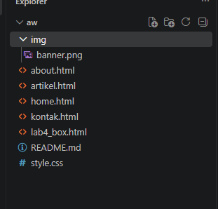
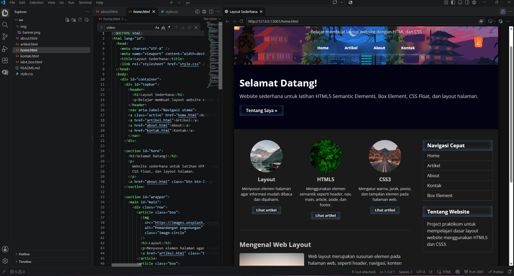
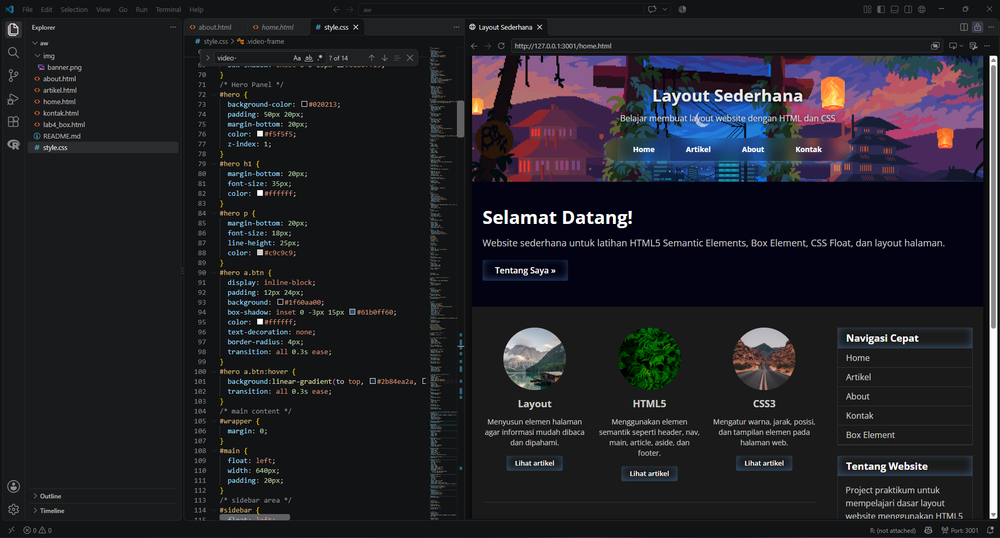
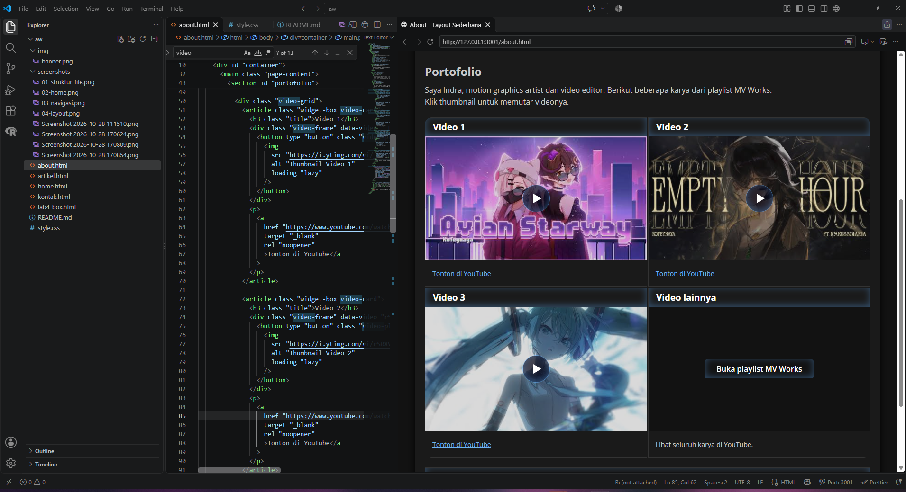
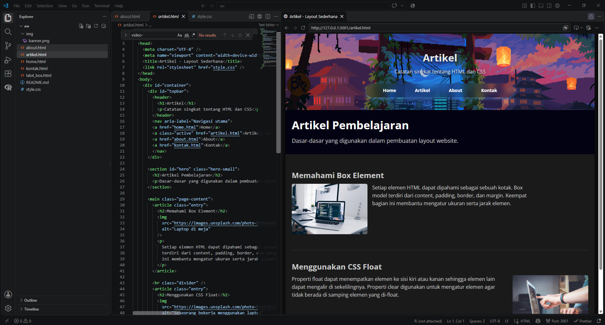
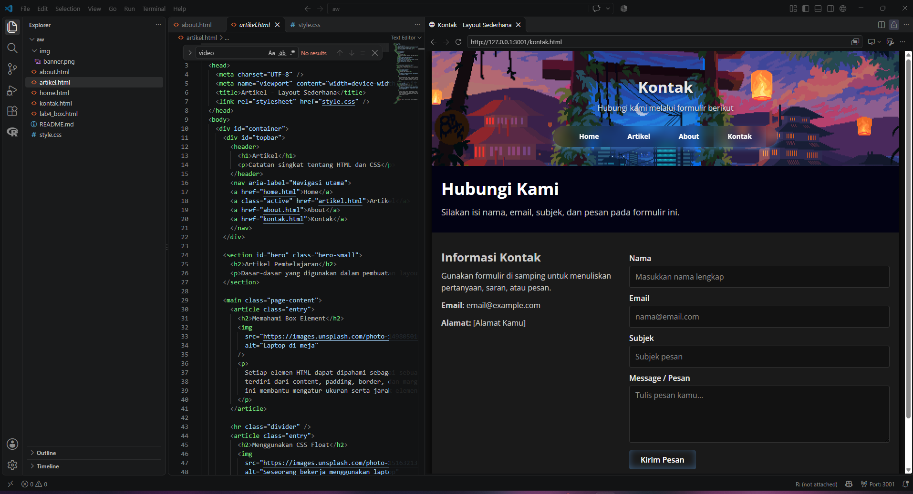
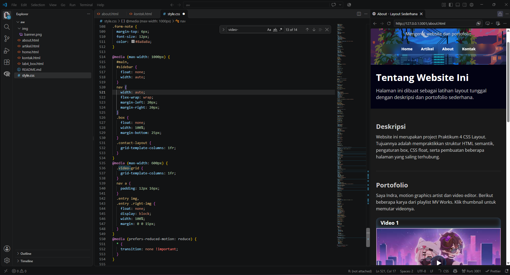

# Praktikum 4 — CSS Layout

## Informasi Praktikum

- **Mata Kuliah:** Pemrograman Web
- **Praktikum:** Praktikum 4 — CSS Layout
- **Nama:** Indra Dwiyantoro
- **NIM:** 312510495
- **Kelas:** I253B

## 1. Tujuan Praktikum

Praktikum ini bertujuan untuk mempelajari penggunaan CSS dalam mengatur tata letak halaman web, mengatur posisi elemen, serta membuat tampilan website yang rapi dan konsisten.

## 2. Langkah-Langkah Praktikum

### Langkah 1 — Menyiapkan Struktur File

Menyiapkan file HTML untuk halaman website dan file CSS eksternal untuk mengatur tampilan halaman.



### Langkah 2 — Membuat Halaman Home

Membuat halaman utama website dengan HTML dan menerapkan CSS untuk mengatur warna, tipografi, jarak, serta tata letak elemen.



### Langkah 3 — Membuat Navigasi

Membuat menu navigasi untuk menghubungkan halaman Home, About, Artikel, dan Kontak. Setiap tautan diuji untuk memastikan halaman tujuan dapat dibuka.


### Langkah 4 — Mengatur Layout

Menggunakan CSS untuk mengatur susunan konten, ukuran elemen, jarak, serta posisi bagian utama halaman dan sidebar jika digunakan.



### Langkah 5 — Membuat Halaman About / Portfolio

Membuat halaman untuk menampilkan informasi atau karya. Halaman portfolio dapat berisi beberapa video YouTube yang ditampilkan melalui embed.



### Langkah 6 — Membuat Halaman Artikel

Menyusun halaman artikel dengan judul dan isi konten yang terstruktur serta menerapkan gaya CSS yang konsisten.



### Langkah 7 — Membuat Halaman Kontak

Membuat halaman kontak untuk menampilkan informasi kontak atau elemen lain sesuai kebutuhan proyek.



### Langkah 8 — Pengujian Tampilan

Memeriksa hasil akhir setiap halaman dan memastikan navigasi serta tata letak berfungsi dengan baik. Jika website dibuat responsif, periksa juga tampilan pada ukuran layar yang lebih kecil.



## 3. Kesimpulan

Melalui praktikum ini, penggunaan CSS membantu mengatur tampilan dan tata letak halaman web agar lebih terstruktur dan konsisten. Pengujian dilakukan untuk memastikan halaman dapat ditampilkan dengan baik dan navigasi berfungsi sesuai tujuan.

## 4. Struktur Folder

```text
Lab4Web/
├── home.html
├── about.html
├── artikel.html
├── kontak.html
├── style.css
├── README.md
├── img
|   └── banner.png
└── screenshots/
    ├── 01-struktur-file.png
    ├── 02-home.png
    ├── 03-navigasi.png
    ├── 04-layout.png
    ├── 05-portfolio.png
    ├── 06-artikel.png
    ├── 07-kontak.png
    └── 08-responsive.png
```
